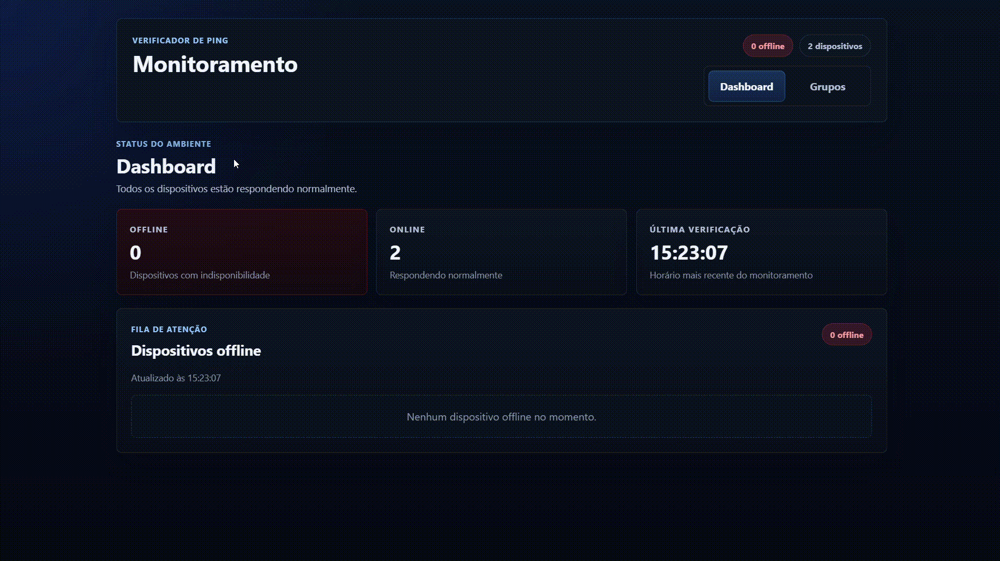

# Ping Verified

**Como acompanhar a disponibilidade de dispositivos de uma rede e identificar rapidamente quedas e recuperações?**

O Ping Verified nasceu de uma necessidade de monitoramento de infraestrutura de TI. O projeto conecta essa experiência prática ao desenvolvimento Full Stack: inventário por grupos, identificação de indisponibilidade, registro de transições e alertas opcionais.

[Demonstração pública](https://ping-verified-fullstack.vercel.app/#dashboard) · [CI](https://github.com/guilhermehgl/ping_verified_fullstack/actions/workflows/ci.yml)

O GIF registra a interface original. A versão simulada preserva os fluxos e a identidade visual e acrescenta uma identificação explícita de demonstração.

## Duas modalidades, a mesma interface

| | Demonstração pública | Monitoramento local confiável |
|---|---|---|
| Dados | Dispositivos fictícios na memória da aba | Inventário e eventos em MongoDB |
| Operações | Cadastro, edição e exclusão de exemplos | Operações reais autorizadas |
| Rede | Nenhum ping, TCP ou chamada à API | ICMP/TCP a partir do computador do backend |
| Alertas | Estado offline fictício e confirmação na tela | Transições e Telegram opcional |
| Persistência | Recarregar restaura os exemplos | MongoDB; até 500 eventos recentes |

Os endereços iniciais usam faixas reservadas para documentação (192.0.2.0/24 e 198.51.100.0/24). Indicadores simulados não são medições de rede. Dados digitados na demonstração ficam somente na memória da aba: não há MongoDB, Telegram ou dependência do Render.

## Tecnologias e decisões

- **Vue 3, Vite e Pinia:** componentes reutilizados entre simulação e modo local, com adaptador de dados isolado.
- **Node.js, Express 5 e Mongoose:** rotas → controllers → services → repositories → MongoDB.
- **ICMP/TCP:** no modo automático, TCP é usado quando a execução de ICMP falha; uma resposta ICMP offline continua offline. TCP verifica a porta configurada, não todos os serviços.
- **Estabilização:** após a primeira leitura, três falhas consecutivas indicam queda e dois sucessos indicam recuperação. Ciclos não se sobrepõem.
- **Eventos e alertas:** transições persistidas e Telegram opcional com espera limitada. Falhas individuais não interrompem os demais dispositivos. Falhas de persistência são registradas no console; o estado continua atualizado e não há fila de reenvio.
- **Segurança proporcional:** o comando público não conecta ao banco, não inicia ciclos e bloqueia inventário/eventos. O modo real exige comando local explícito, recusa produção/Render/Vercel e escuta somente em loopback. CORS não substitui esses controles.

## Demonstração sem backend

Requisito: Node.js 24 LTS e npm.

1. Execute `npm --prefix Frontend ci`.
2. Execute `npm run dev:frontend` e abra o endereço informado pelo Vite.

A simulação é o padrão. Não é necessário criar .env ou configurar banco. Recarregar restaura os dados fictícios.

## Monitoramento real autorizado

1. Instale: `npm --prefix Backend ci` e `npm --prefix Frontend ci`.
2. Copie `Backend/.env.example` para `Backend/.env` e configure um MongoDB próprio. Não publique a URI. Preencha Telegram somente se quiser alertas reais.
3. Crie `Frontend/.env.local` com `VITE_APP_MODE=local` e `VITE_API_BASE_URL=http://127.0.0.1:3000`, cada variável em sua linha.
4. Em terminais separados: `npm run dev:backend` e `npm run dev:frontend`. Abra o frontend em localhost.

O backend precisa executar onde os dispositivos são alcançáveis; cloud não acessa automaticamente sua LAN. ICMP exige o comando ping e as permissões do sistema. Os alvos devem ser autorizados por você.

`npm --prefix Backend start` inicia o processo **público restrito**, sem monitoramento. Para o modo real, use `npm --prefix Backend run start:local`. Não exponha o processo local por túnel, proxy ou port forwarding. Não altere o bind para 0.0.0.0. Não existe autenticação multiusuário.

Opcional: a interface empacotada local continua disponível por `npm run webapp` (porta 3004). Configure VITE_APP_MODE=local e VITE_API_BASE_URL=http://127.0.0.1:3004 antes do build. Também fica restrita ao próprio computador.

## API

| Rota | Processo público padrão | Comando local |
|---|---|---|
| GET / e GET /health | Informações inofensivas | Disponíveis |
| GET /devices | 403 | Estado do último ciclo |
| POST /devices | 403 | Cadastro validado |
| PUT /devices/:id | 403 | Edição validada |
| POST /devices/bulk-delete | 403 | Exclusão dos IDs válidos selecionados |
| GET /events | 403 | Histórico de transições |

## Testes e integração contínua

- `npm --prefix Backend test` e `npm --prefix Backend run check`.
- `npm --prefix Frontend test`, `npm --prefix Frontend run lint` e `npm --prefix Frontend run build`.

Os testes usam mocks de banco, ICMP, TCP e Telegram. Cobrem isolamento público, validações, limiares, falhas e concorrência de ciclos, fallback, seleção com ObjectIds, CRUD fictício e estados de carregamento/erro/vazio. O CI executa os comandos em PRs para master e pushes em master/portfolio, sem banco ou secrets. Não existe workflow de deploy.

## Hospedagem

- Vercel: diretório Frontend, build `npm run build`, saída dist. A demonstração é padrão e ignora a antiga VITE_API_BASE_URL. Não configurar modo real para hospedagem pública.
- Render: diretório Backend, instalação `npm ci` e start `npm start`, sem --local. O novo processo atende health sem MongoDB/Telegram e recusa inventário/eventos.
- A demonstração não requer seed, migração ou alteração de dados.

[Backend](Backend/README.md) · [Frontend](Frontend/README.md)
